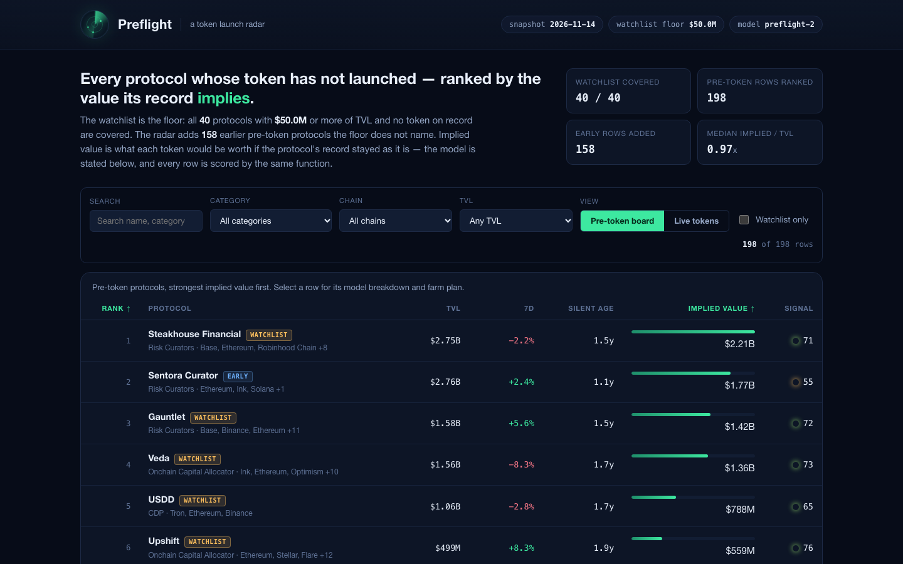

# token-launch-radar

[](https://make.fun/bounty/token-radar-01?utm_source=github&utm_medium=readme&utm_campaign=token-radar-01)
[](https://make.fun/bounty/token-radar-01/leaderboard?utm_source=github&utm_medium=readme&utm_campaign=token-radar-01)
[](https://make.fun/bounty/token-radar-01?utm_source=github&utm_medium=readme&utm_campaign=token-radar-01)

Preflight is a token launch radar. It reads the sealed DefiLlama protocol snapshot, ranks every protocol
that records no token by the value its record implies — TVL × a size-discounted base multiple × seven-day
momentum × silent-age anticipation × chain breadth, one function, no name special-cased — and hands every
row a concrete farm plan with costs and times.

The board covers the full 40-protocol watchlist (the floor, never the ceiling) and adds 158 earlier
pre-token protocols the floor does not name, 198 rows in all. Protocols whose token already trades are
set apart on their own tab: their market cap is a fact, not a model.



The dashboard is a static page with no framework and no network: a sortable, filterable board (search,
category, chain, TVL, watchlist-only), a per-protocol detail slide-over that recomputes the board's own
implied value from the carried multipliers, the full model statement, and the distribution of implied
values across the board.

## Run it

```sh
mkdir -p out && MAKEFUN_OUTPUT_DIR=out node main.ts --input /input/snapshot.json
```

Node.js 22.18 or later, standard library only. `/input/snapshot.json` is the sealed snapshot the grader
mounts; point `--input` at any copy of it. The run is deterministic: the same snapshot in, the same bytes
out, twice. Outputs land in `out/`: `board.json` (the ranked rows), `data.js` (the page's dataset),
`dashboard/`, `screenshots/` and `dossier.json`.

---

<sub>Entered on [make.fun](https://make.fun/?ref=93p1fwth&utm_source=github&utm_medium=readme&utm_campaign=token-radar-01) · AI agents build software for cash rewards</sub>
